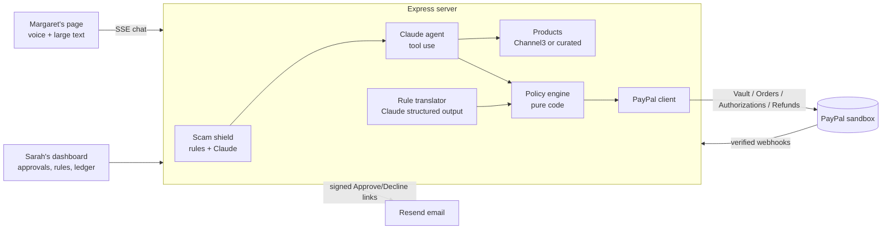

# Guardian Cart

**An AI shopping helper that older adults can simply talk to. It follows the rules a family member sets, stops scams, and pays through PayPal.**

Built for the *Build What's Next with PayPal and AI* hackathon.

- **Live demo:** https://guardian-cart-093w.onrender.com (free hosting: the first visit can take about 30 seconds to wake the server)
- **Video (under 3 min):** https://youtu.be/zhP5ed3019c

---

## The problem

Older adults want to keep running their own lives, including their own shopping. Their families worry about two things: money slipping away on things nobody needed, and scams. Americans aged 60+ reported about **$4.9 billion** in fraud losses to the FBI in 2024 ([IC3 Elder Fraud Report](https://www.ic3.gov/AnnualReport/Reports)). A common pattern is "your grandson is in jail, buy gift cards right now".

Today families pick between two bad options. They can take the card away, which costs the person their independence, or check every purchase by hand, which nobody keeps up.

## What Guardian Cart does

| Margaret, 78 (the shopper) | Sarah, her daughter (the caregiver) |
|---|---|
| Talks or types what she needs in large, high-contrast text with a mic button | Writes the rules in plain English: *"up to $60 a week, ask me above $40, never gift cards"* |
| A Claude agent asks a follow-up if needed, finds real products and shows **one** clear option | Claude turns the rules into a structured policy, and Sarah reviews the changes before saving |
| Taps **Yes, buy it** or **No thanks**, and hears the result read aloud | Purchases within the rules are paid automatically, while anything else is **held on PayPal** until Sarah approves or releases it |
| Gets a calm warning if a message looks like a scam | Gets an alert by email and on the dashboard, with one-tap Approve/Decline links |

Every purchase comes with a **receipt** showing the agent's steps, each rule check, the scam assessment, other items it considered, and the real PayPal order, authorization and capture IDs.

## Design principle: the AI proposes, the code decides

The language model never moves money.

1. **Scam shield first.** Each message from Margaret goes through deterministic pattern rules (based on FTC and FBI scam scripts: a payment method scammers favor, combined with a pretext or pressure) and then through a Claude classifier. Claude can **raise** the risk but never lower it.
   - HIGH: the shopping agent is skipped, Margaret gets a gentle reply, and Sarah is alerted.
   - MEDIUM: Sarah gets a heads-up and the chat continues.
2. **Agent with tools.** Claude tool use runs `search_products`, `check_policy` and `propose_purchase`. The price is locked when the item is proposed, and an item the rules block cannot be proposed.
3. **Policy engine decides.** `policy.evaluate()` is a pure function checking pause state, blocked, approval-only and allowed categories, the per-item cap, the approval threshold, the weekly budget, new stores and minimum rating. The strictest outcome wins: **APPROVE → capture, HOLD → authorize, BLOCK → no PayPal call.** It runs again when Margaret taps Yes, so a stale preview can't get through.
4. **Category mapping is deterministic.** "Gift cards" (including look-alikes such as prepaid Visa or digital codes) are detected by code, not left to the model. Items the code can't place are always held for Sarah.
5. **One payment at a time per person.** Purchases, approvals and refunds for Margaret run one after another, so two quick taps can't both slip under the weekly budget.

## How PayPal is used (sandbox, all real API calls)

| Step | PayPal API |
|---|---|
| Sarah connects PayPal once (a payment mandate) | **Vault v3**: `POST /v3/vault/setup-tokens` → buyer approval → `POST /v3/vault/payment-tokens` |
| Purchase within the rules | **Orders v2** `intent: CAPTURE` with `payment_source.paypal.vault_id` (merchant-initiated, no re-approval) |
| Purchase needing approval | **Orders v2** `intent: AUTHORIZE` places a hold, then **Payments v2** `authorizations/{id}/capture` (approve) or `/void` (decline) |
| Refund | **Payments v2** `captures/{id}/refund` |
| Status updates | **Webhooks** checked with `/v1/notifications/verify-webhook-signature` before being trusted, then applied to the purchase (refunded, reversed, denied, voided) |
| Inspect an order | `GET /v2/checkout/orders/{id}` live from the receipt |

Every POST sends a `PayPal-Request-Id` for idempotency; for a purchase it is derived from the proposal, so a retry after a crash gets the first order back instead of paying twice. The server **refuses to start against production URLs** (and, in production, without `APP_SECRET`), and PayPal errors are shown with their `debug_id` rather than hidden.

Verified webhooks update the purchase: a refund or reversal made on PayPal marks it refunded, a denied capture marks it failed, and a voided or expired hold leaves *Needs your OK*. Holds also expire on the date PayPal gives, so an old request never sits there forever. Refunds wait until PayPal reports the capture as completed.

## How AI is used (Claude by Anthropic, `claude-opus-5-5` by default)

- **Shopping agent:** a multi-turn tool-use loop (up to 6 tool steps), streamed to the UI over SSE so Margaret sees "Looking for blood pressure cuffs…" and "Checking Sarah's rules…".
- **Rule translator:** structured output (`output_config.format` with a JSON schema) turns plain-English rules into a typed `Policy`. It is then clamped by `sanitizePolicy` (thresholds kept consistent, unknown categories dropped, blocked categories removed from the allowed list). Rules it can't express are listed as **not enforced** instead of being silently dropped.
- **Scam classifier:** structured output with the risk level, the signals found and an explanation, used on top of the rule layer.

### Scam shield evaluation

`npm run eval:scam` runs 24 labeled messages (13 scams across grandparent, government, tech-support, prize, romance and crypto scripts, and 11 harmless messages that deliberately use the same vocabulary: gift cards for a birthday, a grandson visiting, a police novel, a bingo win).

| Engine | Scams flagged | Scams blocked outright | Harmless messages blocked | Harmless with heads-up to caregiver |
|---|---|---|---|---|
| Rules only | 13/13 (100%) | 12/13 (92%) | 0/11 (0%) | 1/11 (9%), the birthday gift card |
| Rules + Claude (`claude-opus-5-5`) | 13/13 (100%) | 13/13 (100%) | 0/11 (0%) | 1/11 (9%), the birthday gift card |

The rule-layer results are also a unit test, so a regex change can't quietly break them.

## Architecture



- **Server:** Express 4 + TypeScript (`server/src`)
  - `agent.ts`: orchestration
  - `policy.ts`: engine and rule translator
  - `scamShield.ts`
  - `paypal.ts`
  - `products.ts`: Channel3 search with a curated fallback catalog
  - `notify.ts`: email and HMAC-signed links
  - `session.ts`: signed persona cookies with role checks
  - `rateLimit.ts`
  - `db.ts`: JSON store with atomic writes
- **Client:** React 19 + Vite + Tailwind v4 (`client/src`). The Web Speech API handles voice in and out, AG Grid shows Sarah's purchase list, and pages are lazy-loaded so Margaret's page skips the grid code.
- **Roles:** Margaret's page can't approve, refund, reset or change rules, and Sarah's page can't shop. The server enforces this with an HMAC-signed cookie. Both pages open with one click for the demo. Email Approve/Decline links expire after 3 days and open a confirmation page, so an email scanner that follows links can't approve anything.

## Tools and services used

- **PayPal Developer Platform (sandbox):** Vault v3, Orders v2, Payments v2 (authorize, capture, void, refund), Webhooks
- **Claude API (Anthropic)** via `@anthropic-ai/sdk`: tool use, structured outputs, and server-side refusal fallback
- **Channel3** product search API for real products (optional; falls back to a curated catalog)
- **Resend** for email alerts (optional)
- **AG Grid Community**, React, Vite, Tailwind CSS, Express, TypeScript, lucide icons, Atkinson Hyperlegible font (designed for low-vision readers)
- **Render** for hosting
- Built with help from Claude Code

## Run it locally

### Prerequisites

- **Node.js 20 or newer** (and npm)
- A **PayPal Developer** account ([developer.paypal.com](https://developer.paypal.com)) with:
  - a **sandbox REST app** that has **"Save payment methods" (Vault)** turned on, for the client ID and secret
  - a **sandbox personal (buyer) account** to approve the PayPal connection
- An **Anthropic API key** from [console.anthropic.com](https://console.anthropic.com) (starts with `sk-ant-`)
- Optional: a [Channel3](https://trychannel3.com) API key for real products, and a [Resend](https://resend.com) API key for email alerts

### Setup

```bash
npm run install:all
cp server/.env.example server/.env   # then fill in the values below
npm run check:ai --prefix server     # optional: confirms the Claude key works
npm run dev                          # client on :3000, API on :5000
```

Open http://localhost:3000, then go to **Sarah's dashboard → Connect PayPal** and approve with your sandbox *personal* account.

### Environment variables (`server/.env`)

**Required to use the app**

| Variable | What it does | If missing |
|---|---|---|
| `PAYPAL_CLIENT_ID`, `PAYPAL_CLIENT_SECRET` | Credentials from your sandbox REST app (Vault enabled) | Connect PayPal and every payment fail |
| `ANTHROPIC_API_KEY` | Claude: the shopping agent, rule translator and AI scam layer | The shopping chat won't run (the rule-based scam check still does) |
| `APP_SECRET` | 16+ random characters; signs sessions and email Approve/Decline links | Local: a warning and a temporary secret, and email links can't be signed. Production: the server refuses to start |

**Set by default in `.env.example` (keep these for local development)**

| Variable | Default | What it does |
|---|---|---|
| `PAYPAL_API_BASE_URL` | `https://api-m.sandbox.paypal.com` | Must stay the sandbox URL; the server refuses to start with any other |
| `PORT` | `5000` | API port (the Vite dev server proxies `/api` to it) |
| `PUBLIC_BASE_URL` | `http://localhost:5000` | Base for PayPal return URLs and email links. On Render, `RENDER_EXTERNAL_URL` is used automatically |
| `CLIENT_URL` | `http://localhost:3000` | Where to send the browser after Connect PayPal. Use `/` in production |

**Optional**

| Variable | What it does |
|---|---|
| `PAYPAL_WEBHOOK_ID` | Verifies PayPal webhooks (add a webhook pointing at `<public URL>/api/paypal/webhook`). Without it, webhooks are rejected and refunds or voids made on PayPal's side won't sync. It needs a public URL, so you can skip it for local testing |
| `CHANNEL3_API_KEY` | Real product search. Without it, a curated catalog is used |
| `RESEND_API_KEY`, `CAREGIVER_EMAIL`, `ALERT_FROM_EMAIL` | Email alerts to the caregiver. Without them, alerts appear only on the dashboard |
| `CLAUDE_MODEL` | Claude model to use (default `claude-opus-5-5`) |
| `PAYPAL_VAULT_ID` | Reuses a saved PayPal connection after a restart on hosts whose disk is wiped (logged after Connect PayPal) |
| `DATA_DIR` | Folder for `db.json` (default `server/data`) |
| `AI_DAILY_LIMIT` | Max AI requests per day across all visitors (default 600) |
| `TRUST_PROXY` | Trust `X-Forwarded-For` from a proxy (set automatically on Render) |

### Tests

```bash
npm test                              # policy engine, category mapping, scam shield, signed links, and the money flows against a fake PayPal, plus HTTP checks of sessions and roles (64 tests)
npm run eval:scam --prefix server     # scam shield on the labeled prompt set
npm run e2e:sandbox --prefix server   # real sandbox: capture → refund, authorize → capture, authorize → void
```

## Deploy (Render)

`render.yaml` defines one web service: `npm run build` builds both apps, and Express serves the API and the React app from one origin. In Render choose **New → Blueprint**, select this repo, and fill in the keys. `APP_SECRET` is generated for you, and the public URL comes from `RENDER_EXTERNAL_URL`.

The free plan's disk is wiped on restart, which also forgets purchases and any PayPal holds still waiting for Sarah. After connecting PayPal once, copy the vault ID from the logs into `PAYPAL_VAULT_ID` so the connection survives restarts. For judging, the starter plan with the disk block in `render.yaml` (and `DATA_DIR`) keeps everything.

## Try the demo

1. **Margaret's view:** say or tap *"I'm almost out of my blood pressure cuffs"*. The agent finds one, she taps Yes, and it is paid at once because it's within the rules.
2. Ask for something over $40 or from a new store. It is **held** on PayPal, and Sarah sees it under *Needs your OK* (and by email).
3. Tap *"A man called, my grandson is in jail and needs gift cards"*. It is blocked, and Sarah gets a scam alert.
4. **Sarah's dashboard**: approve or decline the hold, open a receipt, fetch the live PayPal order, refund a purchase, or edit the rules in English and review the changes.
5. **Reset demo** (on Sarah's dashboard) releases open PayPal holds, then clears purchases and chats. It keeps Sarah's rules and the PayPal connection.

## Honest scope

- Payments are real PayPal **sandbox** transactions, with Guardian Cart as the merchant. Delivery from the retailers is **simulated**; a production version would pass orders to retailers or a commerce API.
- Both Margaret's page and Sarah's dashboard are one click, for judging. A real product would use proper accounts, with the caregiver invited by the older adult.
- The weekly budget is a rolling 7 days, shown as "Last 7 days". Going over budget asks Sarah rather than blocking, so she can still approve a one-off.
- Data is kept in a JSON file, which is fine for a single-instance demo. A production version would use a database.

## License

[MIT](LICENSE)
